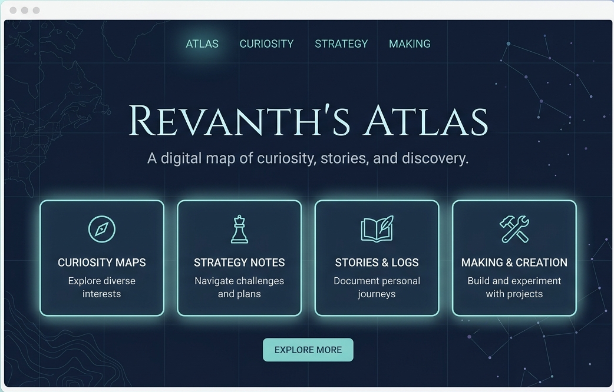

# Revanth’s Atlas

**A living map of curiosity, stories, strategy, making, and everyday discovery.**

 

 

## 🧭 What is Atlas?

Revanth’s Atlas is a personal space for following curiosity, collecting ideas, and turning small interests into projects, reflections, and useful experiments.

It is not a finished portfolio or a fixed website. It is a living map—designed to grow as new interests, questions, and ideas appear.

 

## 🖼️ Atlas Preview

 

## 🗺️ Routes to explore

<table>
  <tr>
    <td width="50%">

### 📖 Reading & Stories

Imagination, overlooked characters, story ideas, and possibilities hidden within books and narratives.

</td>
    <td width="50%">

### 🎮 Games & Thinking

Strategy, decisions, immersive worlds, and the quiet satisfaction of steady improvement.

</td>
  </tr>
  <tr>
    <td width="50%">

### 📊 Learning & Data

Questions, patterns, visual storytelling, and new skills worth exploring.

</td>
    <td width="50%">

### 🛠️ Making & Building

Small experiments, useful tools, and ideas slowly becoming real.

</td>
  </tr>
  <tr>
    <td width="50%">

### 🥗 Food & Well-being

Everyday meals, better choices, and simple systems for feeling better.

</td>
    <td width="50%">

### 📍 Current Coordinates

Where the journey stands today—and where it may be heading next.

</td>
  </tr>
</table>

 

## 🌀 Wormhole Gateway

The Atlas also includes a **wormhole gateway** to my professional journey.

 

## 🚀 Future Routes

- Reading notes, recommendations, and story ideas  
- Game notes, strategies, and favourite moments  
- Learning progress, mini-projects, and data explorations  
- Useful digital tools and browser-based experiments  
- Food experiments, well-being notes, and everyday systems  

 

## 🛠️ Built With

`HTML` · `CSS` · `JavaScript` · `GitHub Pages`

 

**Start anywhere. Follow a route. See what you discover.**

